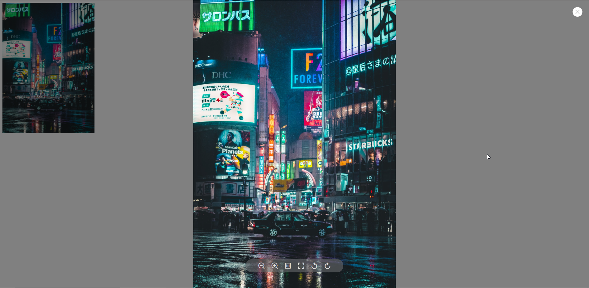

# vue3-image-ipreview
A image preview plugin based on Vue3. 支持typescript🎉

## 介绍
一款基于vue3的桌面端轻量图片预览插件。支持typescript

1.欢迎大家使用~，觉得还行的，动动小手点个star
2.如有问题，请提issue，我会持续迭代。
## npm地址
https://www.npmjs.com/package/vue3-image-ipreview

### 特性
      1.支持传入图片初始旋转角度
      2.支持鼠标滚轮缩放
      3.支持鼠标拖动预览图查看
      4.支持缩放，旋转，原图查看.
      5.自带节流机制，兼顾性能
### 使用npm安装
```javascript
npm install vue3-image-ipreview 
```

### 用法
```typescript
import ImageIpreview from 'vue3-image-ipreview'
import 'vue3-image-ipreview/dist/style.css'

const app = createApp({/.../})
app.use(ImageIpreview).mount('#app')

// 组件中使用
...
<template>
  <div id="app">
    <image-ipreview
     :url="url"
     :isMouseWheel="true"
     :isShowToolBar="true"
     :closeOnPressEscape="true"
     style="width: 300px;"
     :previewSrcList="srcList"
    />
  </div>
</template>

<script lang="ts">

export default {
  name: 'App',
  data() {
    return {
      url: 'https://fuss10.elemecdn.com/8/27/f01c15bb73e1ef3793e64e6b7bbccjpeg.jpeg',
      srcList: [
        {
          url: 'https://fuss10.elemecdn.com/8/27/f01c15bb73e1ef3793e64e6b7bbccjpeg.jpeg',
          degree: 90
        },
        {
          url: 'https://fuss10.elemecdn.com/1/8e/aeffeb4de74e2fde4bd74fc7b4486jpeg.jpeg',
          // degree: 90 省略默认值为0
        },
        {
          url: 'https://fuss10.elemecdn.com/e/5d/4a731a90594a4af544c0c25941171jpeg.jpeg',
          degree: 180
        }
      ]
    };
  }
};
</script>
...
```
### 配置

|       属性名       |  类型   |     描述      | 是否必填 | 默认值 |
| :----------------: | :-----: | :-----------: | :----: | ------ |
|        url         | string |   图片地址    | 是 |        |
|        degree         | number |   图片旋转角度    | 否 |   0     |
| closeOnPressEscape | boolean | esc键关闭预览  |  -     |  true  |
|   isShowToolBar    | boolean |  是否展示工具栏 |  -     |  true  |
|   isMouseWheel    | boolean |  是否开启鼠标滚轮缩放   |  -  |  false  |
| previewSrcList | `object[]` 见下方  | 开启图片预览功能 | -  |         |
| isTransition | boolean  | 是否开启过渡动画 | -  |    false     |

### previewSrcList属性

|       属性名       |  类型   |     描述      | 是否必填 | 默认值 |
| :----------------: | :-----: | :-----------: | :----: | ------ |
|   url             | string   |  图片地址         |  true     |  -  |
| degree             | number  | 初始旋转角度       |  false   |     0     |


### 示例效果


